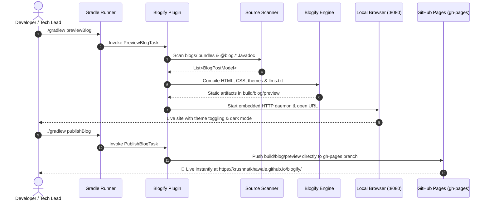

## Why Another Blog Generator?


If you've ever tried maintaining engineering blogs or architecture decision records, you know the pain:

### 💀 1. The Wiki Graveyard
> *"We wrote great docs on Notion 3 months ago... none of it works anymore."*

Code moves at Git commit speed. External wikis don't compile, don't run tests, and don't fail builds. The moment your team refactors an API, your external wiki becomes a graveyard of outdated architecture.

### 📦 2. The 300MB Node.js Tax
> *"Why is our Java backend CI build failing on npm audit vulnerabilities?!"*

Static site generators like Docusaurus, Astro, and Next.js are great—until you realize you just brought `package.json`, `node_modules`, and 40,000 JavaScript files into a clean Java Gradle repository. Why should a backend engineer debug npm lockfile conflicts just to write a blog post?

### 🚨 3. Production JAR Bloat
> *"Don't bundle your documentation viewer inside production Spring Boot."*

Teams attempting to serve docs directly from microservices often bundle Swagger UI, heavy markdown rendering engines, or static controllers into production JARs—inflating container image sizes and needlessly expanding the attack surface.

### 💥 4. CI/CD Token Hell
> *"70 lines of GitHub Actions YAML and expiring PAT tokens just to push HTML?"*

Automating static site hosting shouldn't require managing fragile workflow files, personal access tokens, and waiting 4 minutes for CI runners just to fix a typo. Publishing should be a single, on-demand task from your machine.

### 🤖 5. Invisible to AI Agents
> *"ChatGPT and Cursor couldn't find our core architecture patterns."*

Modern developers code with Cursor, Copilot, and LLMs. If your documentation doesn't export a token-efficient `/llms.txt` and `/llms-full.txt`, AI agents can't index your system design and will hallucinate non-existent APIs.

Blogify solves all five traps: **zero runtime dependencies, zero external toolchains, and 100% on-demand execution directly in Gradle.**

---

## The Story-First Narrative: Problem ➔ Insight ➔ Takeaways

Too much technical documentation is overwhelming—either drowning readers in 500 lines of boilerplate or generic prose generated by AI that lacks practical context.

Blogify enforces a **Story-First** structure:
- **⚠️ The Problem**: What was broken or failing before?
- **💡 The Core Insight**: What is the clever 20% algorithmic or architectural pattern solving it?
- **📐 Architecture Diagrams**: Native client-side Mermaid rendering for sequence and flow charts.
- **🚀 Key Takeaways**: High-signal lessons for system designers.

### Blogify Execution Sequence Workflow



---

## 3 Switchable Themes on the Static UI

Blogify ships with three built-in visual themes switchable directly on the static site with an instant Dark/Light mode toggle:

1. **Primer** (Default): Clean GitHub developer docs style.
2. **Editorial**: Warm paper palette with publication-grade serif typography (Charter & Georgia).
3. **Minimal**: Stark hacker monochrome with crisp 1px borders.

Theme preferences are persisted client-side in `localStorage` without requiring cookies or server-side sessions.

---

## Micro-Snippets with Expandable Drawers

Instead of dumping huge files, authors can present concise micro-snippets (5–15 lines) showing the core algorithmic trick, with full implementations hidden inside collapsible `<details>` drawers:

```java
// BlogSourceScanner.java: zero-overhead scan of root blogs/ directory
public List<BlogPostModel> scanDirectory(File directory) {
    if (!directory.exists()) return Collections.emptyList();
    return Files.walk(directory.toPath())
            .filter(path -> path.getFileName().toString().equals("index.md"))
            .map(path -> markdownParser.parse(path.toFile()))
            .filter(Objects::nonNull)
            .sorted()
            .toList();
}
```

---

## AI Discoverability: Native `llms.txt`

Modern AI tools (ChatGPT, Claude, Grok, Perplexity) frequently crawl engineering documentation. Blogify automatically generates:
- **`/llms.txt`**: Curated markdown manifest listing articles, descriptions, and takeaways.
- **`/llms-full.txt`**: Complete concatenated text corpus for single-prompt LLM ingestion.
- **`robots.txt`**: Permissive configuration allowing AI crawlers (`GPTBot`, `ClaudeBot`, `PerplexityBot`).
- **JSON-LD**: Embedded `TechArticle` structured data in every page header.

---

## Quick Start in Any Gradle Project

Add the plugin to your `build.gradle`:

```groovy
plugins {
    id 'io.github.krushnatkhawale.blogify' version '0.1.0'
}

blogify {
    siteTitle = 'Engineering Blog'
    repoUrl = 'https://github.com/krushnatkhawale/blogify'
    theme = 'primer'
}
```

### On-Demand Commands

```bash
# Preview locally at http://localhost:8080/
./gradlew previewBlog

# Publish directly to GitHub Pages (gh-pages branch) on demand
./gradlew publishBlog
```
