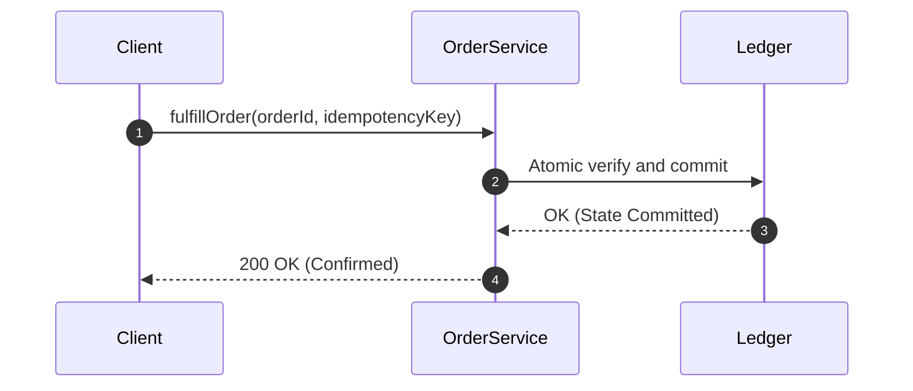

## Why Another Blog Generator?

In modern software engineering teams, technical blogging and architecture decision records often suffer from two extremes:

1. **The Wiki Drift Trap**: Articles written on external platforms (Medium, Substack, Confluence) describe an architecture on day one. By day thirty, the code has evolved, and the blog now teaches outdated patterns.
2. **The Tooling Bloat**: Many static generators require installing Ruby (Jekyll), Node.js (Docusaurus/Astro), or pulling heavy web frameworks directly into production Spring Boot JARs.

Blogify was built to solve this with a single Gradle plugin application: **zero runtime dependencies, zero external toolchains, and 100% on-demand execution.**

---

## The Story-First Narrative: Problem ➔ Insight ➔ Takeaways

Too much technical documentation is overwhelming—either drowning readers in 500 lines of boilerplate or generic prose generated by AI that lacks practical context.

Blogify enforces a **Story-First** structure:
- **⚠️ The Problem**: What was broken or failing before?
- **💡 The Core Insight**: What is the clever 20% algorithmic or architectural pattern solving it?
- **📐 Architecture Diagrams**: Native client-side Mermaid rendering for sequence and flow charts.
- **🚀 Key Takeaways**: High-signal lessons for system designers.

### Example Architecture Workflow



---

## 3 Switchable Themes on the Static UI

Blogify ships with three built-in visual themes switchable directly on the static site with an instant Dark/Light mode toggle:

1. **Primer** (Default): Clean GitHub developer docs style.
2. **Editorial**: Warm paper palette with publication-grade serif typography (Charter & Georgia).
3. **Minimal**: Stark hacker monochrome with crisp 1px borders.

Theme preferences are persisted client-side in `localStorage` without requiring cookies or server-side sessions.

---

## Micro-Snippets with Expandable Drawers

Instead of dumping huge files, authors can present concise micro-snippets (5–15 lines) showing the core algorithmic trick, with full implementations hidden inside collapsible `<details>` drawers:

```java
public String generateIdempotencyKey(OrderRequest request) {
    String payload = request.customerId() + ":" + request.cartDigest();
    return Hashing.sha256().hashString(payload, StandardCharsets.UTF_8).toString();
}
```

---

## AI Discoverability: Native `llms.txt`

Modern AI tools (ChatGPT, Claude, Grok, Perplexity) frequently crawl engineering documentation. Blogify automatically generates:
- **`/llms.txt`**: Curated markdown manifest listing articles, descriptions, and takeaways.
- **`/llms-full.txt`**: Complete concatenated text corpus for single-prompt LLM ingestion.
- **`robots.txt`**: Permissive configuration allowing AI crawlers (`GPTBot`, `ClaudeBot`, `PerplexityBot`).
- **JSON-LD**: Embedded `TechArticle` structured data in every page header.

---

## Quick Start in Any Gradle Project

Add the plugin to your `build.gradle`:

```groovy
plugins {
    id 'io.github.krushnatkhawale.blogify' version '0.1.0'
}

blogify {
    siteTitle = 'Engineering Blog'
    repoUrl = 'https://github.com/krushnatkhawale/blogify'
    theme = 'primer'
}
```

### On-Demand Commands

```bash
# Preview locally at http://localhost:8080/
./gradlew previewBlog

# Publish directly to GitHub Pages (gh-pages branch) on demand
./gradlew publishBlog
```
