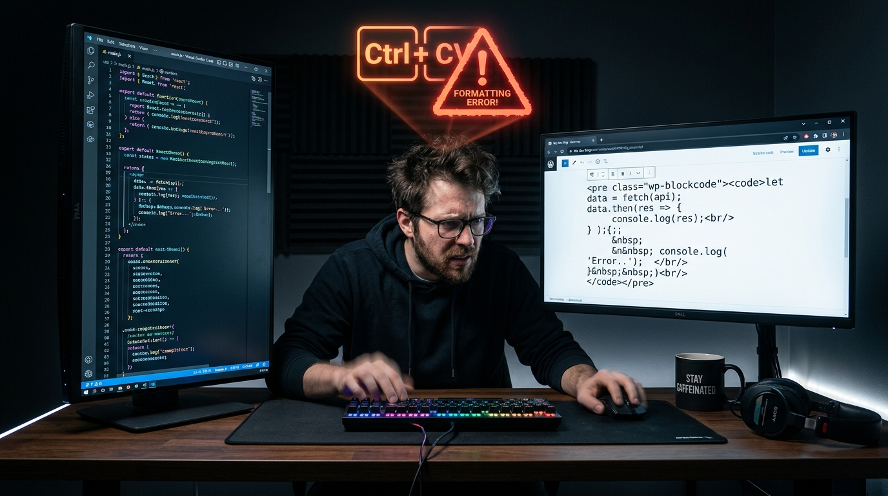
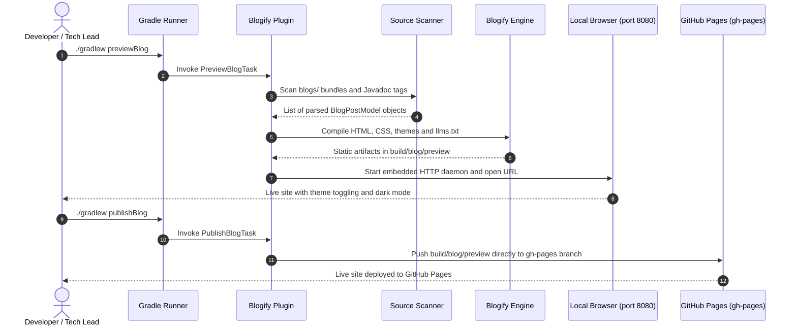

## Why Tech Blogging Is Hard





Most developers and tech bloggers start with great intentions. We want to share lessons learned, explain architecture decisions, and help other engineers. But maintaining a blog quickly becomes exhausting:

### ⏳ 1. Writing Takes Too Much Time
Drafting a technical guide from scratch—explaining the problem, structuring the narrative, and formatting code—often takes 4 to 8 hours. Between sprint deadlines and shipping features, few engineers have time for that.

### 🔄 2. Code Changes, Blogs Don't
Software is never static. A month after publishing, you refactor a service, upgrade a library, or change method signatures. Your blog now teaches outdated code that confuses readers.

### 📋 3. Copy-Pasting Code Snippets
Switching between your code editor and a web blog platform to copy, format, and re-indent code snippets is tedious and easily introduces syntax errors.

### ⚙️ 4. Blog Tools Are Too Complicated
Most blogging tools require learning separate website frameworks, installing extra runtimes, or wrestling with templates and CSS just to share a few paragraphs and code samples.

### 🚀 5. Publishing Is a Pain
Setting up hosting services, deployment keys, and continuous delivery scripts makes publishing feel like an operations project instead of simple writing.

---

## The Solution: AI-Automated Blogging with Blogify

Blogify was built to make technical blogging effortless by pairing **AI automation** with a **zero-overhead Gradle plugin**:

1. **Draft with AI in Seconds**: Feed your code or system design to your favorite AI assistant (ChatGPT, Claude, Cursor, Copilot) and ask it to draft a Blogify leaf bundle.
2. **Never Out of Sync**: Blog articles live right in your project repository under `blogs/`. Code snippets and architecture decisions stay anchored to your Git history.
3. **Zero Extra Tools to Install**: No Node.js, Ruby, or website generators needed. A single Gradle plugin handles responsive HTML generation, dark/light themes, and interactive Mermaid diagrams.
4. **Publish in One Command**: Run `./gradlew publishBlog` to build and deploy directly to GitHub Pages on demand—no servers, tokens, or complex setups required.

---

## The Story-First Narrative: Problem ➔ Insight ➔ Takeaways

Too much technical documentation is overwhelming—either drowning readers in 500 lines of boilerplate or generic prose generated by AI that lacks practical context.

Blogify enforces a **Story-First** structure:
- **⚠️ The Problem**: What was broken or failing before?
- **💡 The Core Insight**: What is the clever 20% algorithmic or architectural pattern solving it?
- **📐 Architecture Diagrams**: Native client-side Mermaid rendering for sequence and flow charts.
- **🚀 Key Takeaways**: High-signal lessons for system designers.

### Blogify Execution Sequence Workflow



---

## 3 Switchable Themes on the Static UI

Blogify ships with three built-in visual themes switchable directly on the static site with an instant Dark/Light mode toggle:

1. **Primer** (Default): Clean GitHub developer docs style.
2. **Editorial**: Warm paper palette with publication-grade serif typography (Charter & Georgia).
3. **Minimal**: Stark hacker monochrome with crisp 1px borders.

Theme preferences are persisted client-side in `localStorage` without requiring cookies or server-side sessions.

---

## Micro-Snippets with Expandable Drawers

Instead of dumping huge files, authors can present concise micro-snippets (5–15 lines) showing the core algorithmic trick, with full implementations hidden inside collapsible `<details>` drawers:

```java
// BlogSourceScanner.java: zero-overhead scan of root blogs/ directory
public List<BlogPostModel> scanDirectory(File directory) {
    if (!directory.exists()) return Collections.emptyList();
    return Files.walk(directory.toPath())
            .filter(path -> path.getFileName().toString().equals("index.md"))
            .map(path -> markdownParser.parse(path.toFile()))
            .filter(Objects::nonNull)
            .sorted()
            .toList();
}
```

---

## AI Discoverability: Native `llms.txt`

Modern AI tools (ChatGPT, Claude, Grok, Perplexity) frequently crawl engineering documentation. Blogify automatically generates:
- **`/llms.txt`**: Curated markdown manifest listing articles, descriptions, and takeaways.
- **`/llms-full.txt`**: Complete concatenated text corpus for single-prompt LLM ingestion.
- **`robots.txt`**: Permissive configuration allowing AI crawlers (`GPTBot`, `ClaudeBot`, `PerplexityBot`).
- **JSON-LD**: Embedded `TechArticle` structured data in every page header.

---

## Quick Start in Any Gradle Project

Add the plugin to your `build.gradle`:

```groovy
plugins {
    id 'io.github.krushnatkhawale.blogify' version '0.1.0'
}

blogify {
    siteTitle = 'Engineering Blog'
    repoUrl = 'https://github.com/krushnatkhawale/blogify'
    theme = 'primer'
}
```

### On-Demand Commands

```bash
# Preview locally at http://localhost:8080/
./gradlew previewBlog

# Publish directly to GitHub Pages (gh-pages branch) on demand
./gradlew publishBlog
```
